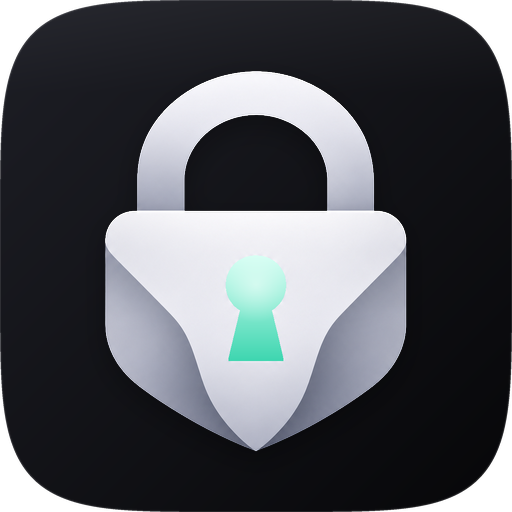

<p align="center"></p>

# OwLock

[](https://github.com/Owaleee/OwLock/actions/workflows/ci.yml)
[](https://github.com/Owaleee/OwLock/releases/latest)
[](LICENSE)

Gerenciador de senhas local, offline e de código aberto, escrito em Python, com interface em HTML, CSS e JavaScript numa janela nativa.

O OwLock guarda suas contas em um único arquivo criptografado, protegido por uma senha mestra. Nenhum dado sai do seu computador e o aplicativo não usa a rede.

**[Baixar a versão mais recente](https://github.com/Owaleee/OwLock/releases/latest)** · [Roadmap](ROADMAP.md)

## Funcionalidades

- Cofre cifrado com senha mestra.
- Interface escura, com animações, em janela nativa.
- Layout que se adapta a telas pequenas.
- Resumo do cofre: total de contas, quantas têm 2FA e quantas precisam de atenção.
- Para cada conta: serviço, login ou e-mail, senha, se possui 2FA e qual aplicativo autenticador é usado, além de notas.
- Medidor de força em cada senha e filtro **Atenção**, para ver as contas com senhas fracas ou razoáveis.
- Senha revelada só sob demanda, pelo botão **Mostrar**.
- Busca que não diferencia maiúsculas, minúsculas nem acentos, em serviço, login, aplicativo de 2FA e notas.
- Gerador de senhas fortes, com tamanho e tipos de caractere escolhidos por você.
- Troca da senha mestra, que recifra o cofre com um novo salt.
- Categorias com cor e ícone, filtro por categoria e tela própria para criar e editar.
- Histórico de senhas: data de criação da conta e cada senha anterior com a data da troca (até 20 versões), com opção de mostrar ou copiar.
- Site da conta, com botão para abrir no navegador padrão.
- Biblioteca de links com 67 serviços (Google, Steam, Epic Games, Discord, Netflix, Nubank, gov.br...): ao digitar o nome, o app sugere o serviço e preenche o link de login oficial. Os links podem ser alterados e novos serviços adicionados nos Ajustes.
- Ícones das plataformas no estilo de ícone de app, embutidos no programa (sem baixar nada da internet), com opção de escolher outro ícone ou usar a letra.
- Copiar login ou senha para a área de transferência, com contagem visual e limpeza automática (10 a 90 segundos; recomendado: 30).
- Bloqueio automático após um tempo sem uso (1 a 30 minutos; recomendado: 5).
- **No Windows, sempre à mão:** ícone nos ícones ocultos da barra de tarefas (Abrir, Busca rápida, Gerar senha e copiar, Bloquear agora, Iniciar com o Windows), busca rápida pelo atalho **Ctrl+Shift+Espaço** de qualquer programa, opção de iniciar com o Windows e de bloquear ao minimizar ou ao travar o Windows (Win+L).
- **Saúde das senhas:** avisos de senha fraca, repetida em outras contas ou sem troca há mais de 1 ano, reunidos no filtro **Atenção**.
- **Favoritas** no topo da lista.
- **Backups com histórico:** até 20 versões cifradas do cofre, com opção de restaurar; ao trocar a senha mestra, todos passam a abrir só com a senha nova.
- **Importar** contas do CSV exportado pelo Chrome, Edge, Gerenciador de Senhas do Google, Bitwarden ou Firefox, com prévia, detecção de contas repetidas e opção de apagar o CSV depois.
- **Exportar** o cofre em CSV, com confirmação da senha mestra (o próprio OwLock importa esse arquivo de volta).
- Uma só janela por cofre: abrir o OwLock de novo traz a janela que já está aberta (também quando ele está na bandeja).
- **Atalhos de teclado:** Ctrl+F buscar, Ctrl+N nova conta, Ctrl+Shift+C copiar a senha da conta aberta e Ctrl+L bloquear.
- Backup automático (`.bak`) da versão anterior do arquivo e gravação atômica, que evita corromper o cofre se o programa for interrompido durante um salvamento.

## Download (Windows)

Na página de [Releases](https://github.com/Owaleee/OwLock/releases/latest) há duas opções:

- **`OwLock-Setup.exe` (recomendado):** instala só para o seu usuário, sem pedir administrador, com atalho no menu Iniciar e desinstalador em Configurações > Aplicativos. Para atualizar, basta rodar o instalador da versão nova. Desinstalar **não apaga** o seu cofre.
- **`OwLock.exe` (portátil):** um único arquivo, sem instalação. Útil num pendrive.

Não precisa instalar Python nem nada.

O app usa o Microsoft Edge WebView2, que já vem instalado no Windows 10 e 11 atualizados.

Como o executável não tem assinatura digital, o Windows SmartScreen pode mostrar um aviso na primeira vez: clique em **Mais informações** e depois em **Executar assim mesmo**. Se quiser conferir a integridade do download, compare o hash SHA-256 do arquivo com o `SHA256SUMS.txt` publicado na mesma release (`Get-FileHash OwLock-Setup.exe` no PowerShell).

## Executar a partir do código-fonte

### Windows

1. Instale o Python 3.10 ou superior pelo site [python.org](https://www.python.org/downloads/). No instalador, marque a opção **Add to PATH**.
2. Abra o terminal (PowerShell ou Prompt de Comando) e execute:

```bash
git clone https://github.com/Owaleee/OwLock.git
cd OwLock
python -m venv .venv
.venv\Scripts\activate
pip install -e .
owlock
```

### Linux e macOS

Requer Python 3.10 ou superior.

```bash
git clone https://github.com/Owaleee/OwLock.git
cd OwLock
python -m venv .venv
source .venv/bin/activate
pip install -e .
owlock
```

No Linux, o pywebview precisa de um backend gráfico. Depois do `pip install -e .`, instale o backend Qt com `pip install "pywebview[qt]"` (ou o backend GTK, se preferir).

Também é possível executar com `python -m owlock`.

### Escolhendo o arquivo do cofre

Por padrão, o cofre fica na pasta `.owlock` dentro da pasta do seu usuário, no arquivo `owlock.vault`. Para usar outro arquivo, informe o caminho com a opção `--vault`:

```bash
owlock --vault CAMINHO/do/meu-cofre.vault
```

## Segurança

Para abrir o cofre são necessárias **duas coisas**: a **senha mestra** e a **Chave Secreta**, uma chave aleatória de 130 bits guardada no seu computador (Gerenciador de Credenciais do Windows). O modelo de ameaças completo está no [SECURITY.md](SECURITY.md).

- **Derivação:** a senha mestra passa pelo Argon2id (3 iterações, 64 MiB, paralelismo 4, salt aleatório de 16 bytes) e é combinada com a Chave Secreta via HKDF-SHA256. O resultado tranca a chave do cofre.
- **Cifragem:** AES-256-GCM. Os metadados e cada conta são cifrados separadamente, ligados ao identificador do cofre e da conta; o cabeçalho é autenticado.
- **Arquivo vazado não basta:** sem a Chave Secreta não dá nem para começar a adivinhar a senha mestra.
- **Kit de emergência:** a Chave Secreta é mostrada na criação do cofre, com uma página para salvar e imprimir. Ela é necessária para abrir o cofre em outro computador.
- **Troca de senha instantânea:** só a "tranca" da chave do cofre é refeita, e o `.bak` é atualizado para não abrir com a senha antiga.
- **Sem rede:** o OwLock não envia nem recebe dados.

### Interface

A interface roda numa janela do pywebview, e estas regras protegem os dados que ela exibe:

- **Senhas fora da listagem:** a lista de contas nunca recebe senhas. A senha só chega à interface ao clicar em **Mostrar** (`reveal_password`) ou no formulário de edição.
- **Cópia pelo Python:** a cópia é feita pelo Python, que limpa a área de transferência após o prazo escolhido (30 segundos por padrão), somente se ela ainda contiver o texto copiado.
- **Sem `innerHTML` com dados:** textos do usuário são sempre gravados com `textContent`, o que evita XSS, já que um ataque desse tipo daria acesso ao cofre.
- **Content-Security-Policy restrita:** a política permite apenas recursos locais (`default-src 'self'`), fontes locais e nenhuma requisição para a internet. Scripts inline continuam proibidos. A exceção é `'unsafe-eval'` em `script-src`, exigida pelo pywebview, que cria as funções da ponte (`window.pywebview.api`) com `new Function`; por isso a defesa contra XSS depende de não usar `innerHTML` com dados.
- **Bloqueio feito no Python:** a Api bloqueia o cofre sozinha após o tempo escolhido sem atividade (5 minutos por padrão). A interface apenas mostra a contagem.

### Limitações

Este é um projeto pessoal e precisa ser usado com consciência dessas limitações:

- **Não existe recuperação.** Sem a senha mestra ou sem a Chave Secreta (guarde o Kit de emergência), os dados do cofre são perdidos.
- **Computador comprometido:** se o sistema estiver infectado por keylogger ou malware, nenhum gerenciador local oferece proteção suficiente.
- **Dados na memória:** enquanto o cofre estiver desbloqueado, os dados ficam na memória do processo.
- **Metadados:** o arquivo revela a quantidade de contas, mas não os nomes, logins, senhas, categorias ou links.
- **Arquivos CSV não são protegidos:** o CSV exportado (e o que você baixa de outro gerenciador para importar) tem as senhas em texto puro. Apague-o assim que não precisar mais dele.
- **Sem auditoria independente:** o código não passou por auditoria de segurança externa. Para uso crítico, considere também soluções auditadas, como [Bitwarden](https://bitwarden.com/) ou [KeePassXC](https://keepassxc.org/).

### Recomendação

Faça cópias do arquivo `.vault` em outro local, como um pendrive ou um serviço de nuvem: sem a Chave Secreta ele não pode ser atacado. Guarde o Kit de emergência separado do arquivo.

## Formato do arquivo

O cofre é um JSON versionado (formato v2; cofres v1 são convertidos automaticamente na primeira abertura, com cópia `.v1-backup`):

```json
{
  "format": "owlock-vault", "version": 2, "vault_id": "<uuid>",
  "kdf": {"name": "argon2id", "salt": "<b64>", "time_cost": 3, "memory_cost": 65536, "parallelism": 4},
  "secret_key": {"id": "<16 hex>"},
  "cipher": {"name": "aes-256-gcm"},
  "key":     {"nonce": "<b64>", "ciphertext": "<b64>"},
  "meta":    {"nonce": "<b64>", "ciphertext": "<b64>"},
  "entries": [{"id": "<uuid>", "nonce": "<b64>", "ciphertext": "<b64>"}]
}
```

`key` é a chave do cofre trancada pela senha mestra + Chave Secreta; `meta` guarda categorias, ajustes e serviços personalizados; cada item de `entries` é uma conta cifrada separadamente, o que prepara a sincronização com o celular.

## Arquitetura

```
owlock/
  __main__.py      # `owlock` ou `python -m owlock`: lê --vault e abre o aplicativo
  core/            # sem dependência de interface; reaproveitável em outras interfaces
    strength.py    # força da senha (0 a 4), sem dependências
    models.py      # Entry, Category (dataclasses), cores e ícones das categorias
    catalog.py     # biblioteca de serviços: links de login, apelidos e ícones
    data/          # services.json (67 serviços) e brand_icons.json
    crypto.py      # Argon2id, HKDF e AES-256-GCM
    secret_key.py  # Chave Secreta: geração, formato OW2-…, verificação
    keystore.py    # onde a Chave Secreta fica guardada (chaveiro do sistema ou arquivo protegido)
    health.py      # saúde das senhas: repetidas e antigas
    transfer.py    # importar CSV (Chrome/Edge/Google, Bitwarden, Firefox, OwLock) e exportar CSV
    vault.py       # Vault: criar, abrir, CRUD, salvar (escrita atômica), trocar senha mestra
    generator.py   # gerador de senhas com `secrets`
    errors.py      # WrongPasswordError, VaultCorruptedError, VaultExistsError
    (vault.py também guarda categorias, ajustes, histórico e serviços personalizados)
  app/
    api.py         # Api: única ponte entre a interface e o núcleo
    main.py        # abre a janela pywebview com a Api
    api_desktop.py # métodos da bandeja e da busca rápida
    api_transfer.py # métodos de importar e exportar
    config.py      # preferências do aparelho (bandeja, atalho), fora do cofre
    desktop/       # Windows: bandeja, atalho global, tela travada, iniciar com o Windows, instância única
    devserver.py   # SÓ desenvolvimento: serve a interface no navegador (127.0.0.1) com a mesma Api via HTTP
  web/             # index.html, styles.css, app.js, bridge.js, fonts/, img/, icons/brands/
packaging/         # executável (PyInstaller), instalador (Inno Setup), ícone do app e script dos ícones de marcas
tests/             # pytest: núcleo, Api, servidor de desenvolvimento e teste ponta a ponta (e2e)
.github/workflows/ # CI (Linux e Windows), build de teste e geração do instalador e do OwLock.exe nas releases
```

O núcleo (`owlock/core`) não depende da interface. Isso permite reaproveitar a lógica de cofre em outras interfaces, como uma API ou um aplicativo móvel. A interface (HTML, CSS e JavaScript) só conversa com o núcleo pela classe `Api`, em `owlock/app/api.py`. O servidor de desenvolvimento usa essa mesma classe, então a interface se comporta igual no navegador e na janela nativa.

## Testes

Para instalar as dependências de desenvolvimento e executar os testes:

```bash
pip install -e ".[dev]"
pytest
```

O GitHub Actions executa a suíte no Linux e no Windows a cada push para a `main` e em pull requests.

### Teste ponta a ponta da interface

O teste de fumaça abre a interface no Chrome (headless) contra o servidor de desenvolvimento e confere o fluxo principal: desbloquear, listar, buscar, mostrar senha, criar e excluir conta, gerador, ajustes e layout de celular. As capturas de tela são salvas em `/tmp/owlock-shots/`.

```bash
# 1. dependências (uma vez)
cd tests/e2e && npm i

# 2. servidor de desenvolvimento com cofre de teste (na raiz do projeto)
cd ../..
rm -f /tmp/owlock-e2e.vault
python -m owlock.app.devserver --vault /tmp/owlock-e2e.vault --seed --port 8765 &

# 3. teste
cd tests/e2e && node smoke.mjs
```

Variáveis opcionais: `OWLOCK_URL`, `CHROME_PATH` (padrão `/usr/bin/google-chrome`) e `OWLOCK_SHOTS`. O teste sai com código diferente de 0 se algo não aparecer. Encerre o servidor depois (`kill %1`).

O servidor de desenvolvimento é só para desenvolvimento: ele escuta apenas em `127.0.0.1`, cria um cofre de teste com `--seed` e não deve ser usado com dados reais.

## Gerar o executável

```bash
pip install "pyinstaller>=6"
pyinstaller --noconfirm --onefile --windowed --name OwLock \
  --add-data "owlock/web:owlock/web" --collect-all webview --paths . \
  packaging/run_owlock.py
```

No Windows, o `--add-data` usa `;` como separador: `--add-data "owlock/web;owlock/web"`, como no workflow de release.

O arquivo fica em `dist/`. Para gerar também o instalador, instale o [Inno Setup 6](https://jrsoftware.org/isinfo.php) e rode `iscc /DAppVersion=1.0.0 packaging\owlock.iss` (sai `dist/OwLock-Setup.exe`). O workflow **Build** faz os dois no GitHub sem publicar nada (aba Actions > Build > Run workflow).

Para publicar uma nova versão, atualize a versão em `owlock/__init__.py` e `pyproject.toml`, escreva as notas em `docs/releases/vX.Y.Z.md` e crie a release no GitHub com a tag `vX.Y.Z` (ou envie a tag com `git push origin vX.Y.Z`, e o workflow cria a release com o título e as notas desse arquivo). O workflow roda os testes, confere se a tag bate com a versão, gera o instalador e o `OwLock.exe` e anexa tudo à release.

## Roteiro

Versões entregues e próximos passos estão no [ROADMAP.md](ROADMAP.md). Em resumo:

- **v1.0:** versão estável para o dia a dia, com instalador para Windows.
- **v1.1:** códigos 2FA (TOTP) opcionais.
- **v1.2:** extensão de navegador para preencher login e senha.
- **v2.0:** aplicativo de celular com pareamento por QR code e sincronização.

## Créditos

Ícones de marcas do projeto [Simple Icons](https://simpleicons.org) (CC0 1.0). As marcas pertencem aos seus respectivos donos e são usadas apenas para identificar cada serviço. Para atualizar os ícones, veja `packaging/build_brand_icons.py`.

## Licença

Este projeto está licenciado sob a [Licença MIT](LICENSE).
